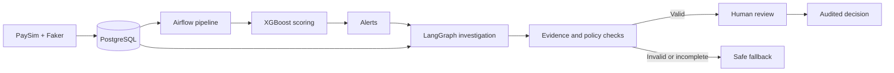

# MuleWatch

**An AI investigation copilot for money-mule alerts.**


MuleWatch scores suspicious account activity and prepares evidence-backed investigation reports for human analysts. It uses synthetic PaySim transactions and Faker-generated profiles; it does not make autonomous account decisions.

## What it does

- Scores transaction activity with XGBoost and explains features with SHAP.
- Runs an Airflow data pipeline backed by PostgreSQL.
- Investigates alerts with LangGraph, read-only tools, and pgvector retrieval.
- Masks PII and checks for prompt injection, invalid citations, and unsafe output.
- Pauses cases for human review and records actions in a tamper-evident audit trail.

## Architecture



## Getting started

Requirements: Python 3.14, Docker, and credentials for your chosen LLM provider.

```powershell
git clone https://github.com/thearyangupta/MuleWatch.git
cd MuleWatch
python -m venv .venv
.\.venv\Scripts\Activate.ps1
pip install -e .
docker compose up -d postgres
```

Apply the database schemas in `db/` and initialize the LangGraph checkpointer. Configure the LLM provider in an untracked `.env` file, then start the API:

```powershell
$env:MULEWATCH_REVIEW_API_KEY = "your-local-test-key"
python -m uvicorn scoring.api:app --host 127.0.0.1 --port 8000
```

API docs: http://127.0.0.1:8000/docs

The analyst UI is available at http://localhost:8080 after configuring local JWT credentials and starting the stack:

```powershell
docker compose up --build -d
```

## Human review API

| Endpoint | Purpose |
|---|---|
| `POST /investigate/{alert_id}` | Start an investigation |
| `GET /cases?status=AWAITING_REVIEW` | List pending reviews |
| `GET /cases/{id}` | View case details |
| `POST /cases/{id}/decision` | Approve, override, or escalate |
| `GET /cases/{id}/audit` | View audit history |
| `POST /score` | Score an alert |

Review and audit endpoints require `X-Review-API-Key`.

## Testing

```powershell
python -m ruff check .
python -m ruff format --check .
python -m pytest tests --ignore=tests/test_dag_integrity.py -q
python -m scripts.verify_audit
```

Frontend checks: `cd web; npm ci; npm run lint; npm run typecheck; npm run test; npm run test:e2e`. Airflow integration tests require their separate runtime.

## Evaluation status

The frozen evaluation set contains 35 cases. The latest smoke experiment ran 15 investigations across three configurations: no graph errors, 100% citation validity, and 100% policy compliance on measured cases. Action accuracy, escalation recall, and injection resistance are **not measured**; labels require independent review. Smoke results are not production-quality guarantees.

See the [evaluation framework](docs/EVALS.md), [experiment results](docs/EXPERIMENTS.md), [AI system card](docs/AI_SYSTEM_CARD.md), and [failure review](docs/FAILURES.md).

## Limitations

- Synthetic data does not represent real banking conditions.
- A score or evidence citation does not prove criminal activity.
- Injection defenses are not guaranteed to stop every attack.
- Human review is required for consequential decisions.
- Audit hash chaining is tamper-evident, not tamper-proof.
- Production use requires further security, compliance, and end-to-end validation.
