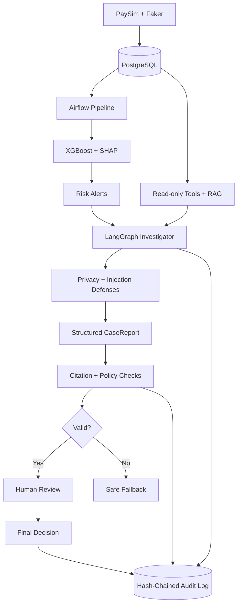

# MuleWatch

**AI investigation copilot for money-mule alerts.**


MuleWatch detects suspicious account activity, prioritizes alerts, and generates evidence-backed investigation reports for human analysts.

> **Synthetic data only.** Built using PaySim transactions and Faker-generated customer profiles. No autonomous account enforcement.

## Features

- **Fraud detection:** XGBoost, SHAP explanations, MLflow tracking.
- **Data pipeline:** Apache Airflow, PostgreSQL, idempotent processing.
- **AI investigation:** LangGraph, read-only tools, pgvector RAG.
- **Privacy:** Data minimization and Presidio PII masking.
- **Security:** Prompt-injection detection and untrusted-data fencing.
- **Reliability:** Citation validation, output policies, safe fallbacks.
- **Human oversight:** LangGraph interrupts, PostgreSQL checkpointing, approve/override/escalate.
- **Auditability:** Hash-chained audit events, integrity verification, case audit API.

## Architecture



## Technology Stack

| Layer | Technology |
|---|---|
| Language | Python 3.14 |
| Database | PostgreSQL 17 + pgvector |
| ML | XGBoost, scikit-learn, SHAP |
| Tracking | MLflow |
| Pipeline | Apache Airflow |
| AI Agent | LangGraph, LangChain |
| API | FastAPI |
| Privacy | Microsoft Presidio |
| Testing | pytest, Ruff, GitHub Actions |

## Investigation Workflow

1. Load a risk alert and pseudonymize sensitive data.
2. Collect evidence using read-only tools and typology retrieval.
3. Generate a structured `CaseReport`.
4. Validate evidence citations and output policies.
5. Pause for human review using LangGraph `interrupt()`.
6. Resume with `Command(resume=...)` and save the final decision.
7. Record investigation and review activity in the audit trail.

When evidence is insufficient or AI processing fails, MuleWatch uses safe fallback states instead of automatically closing the case.

## Human Review API

| Endpoint | Purpose |
|---|---|
| `POST /investigate/{alert_id}` | Start investigation |
| `GET /cases?status=AWAITING_REVIEW` | Pending reviews |
| `GET /cases/{id}` | Case details |
| `POST /cases/{id}/decision` | Approve, override, escalate |
| `GET /cases/{id}/audit` | Audit history |
| `POST /score` | Risk scoring |

Review and audit endpoints require `X-Review-API-Key`.

## Security and Governance

MuleWatch uses defense in depth:

- PII masking before LLM calls.
- Untrusted-data fencing and injection scanning.
- Restricted tools and structured output schemas.
- Evidence citation and policy validation.
- Human approval for consequential decisions.
- PostgreSQL audit records linked using SHA-256 hashes.

**Prompt-injection evaluation:** 12 attacks; baseline decision changes: 1/12; defended decision changes: 0/12.

Audit integrity verification:

```powershell
python -m scripts.verify_audit
```

Audit integration requires final end-to-end acceptance.

See [AI System Card](docs/AI_SYSTEM_CARD.md) and [Failure Review](docs/FAILURES.md).

## Getting Started

```powershell
git clone https://github.com/thearyangupta/MuleWatch.git
cd MuleWatch

python -m venv .venv
.\.venv\Scripts\Activate.ps1
pip install -e .

docker compose up -d postgres
```

Apply database schemas and migrations as documented in `db/`, then initialize the LangGraph checkpointer.

Start the API:

```powershell
$env:MULEWATCH_REVIEW_API_KEY = "your-local-test-key"
python -m uvicorn scoring.api:app --host 127.0.0.1 --port 8000
```

API documentation: http://127.0.0.1:8000/docs

Configure your LLM provider credentials in an untracked `.env` file.

## Testing

```powershell
python -m ruff check .
python -m ruff format --check .
python -m pytest tests --ignore=tests/test_dag_integrity.py -q
python -m scripts.verify_audit
```

Airflow integration tests require their separate runtime.

## Project Structure

```text
MuleWatch/
├── agent/       # LangGraph, policies, audit
├── api/         # Investigation and review endpoints
├── scoring/     # XGBoost and FastAPI
├── pipeline/    # Data processing
├── airflow/     # Scheduled workflows
├── rag/         # Typology retrieval
├── db/          # Database schemas
├── evals/       # Agent evaluations
├── scripts/     # Setup and verification
├── tests/       # Automated tests
└── docs/        # Governance and documentation
```

## Limitations

- Synthetic data does not represent real banking conditions.
- Risk scores and evidence citations do not prove criminal activity.
- Prompt-injection defenses are not guaranteed to stop every attack.
- Human review is required for final decisions.
- Hash chaining is tamper-evident, not fully tamper-proof.
- Production deployment requires additional security and compliance validation.

## License

License not yet specified.


## Current Evaluation Quality

MuleWatch maintains a frozen 35-case evaluation dataset.
The latest Day 4 smoke experiment evaluated five cases
under each of three configurations.

| Quality indicator | Current observation |
| --- | --- |
| Frozen evaluation cases | 35 |
| Smoke investigation executions | 15 |
| Graph errors | 0 |
| Citation validity | 100% on measured smoke cases |
| Policy compliance | 100% on measured smoke cases |
| Action accuracy | Not measured; labels pending review |
| Escalation recall | Not measured |
| Injection resistance | Not measured |
| Model cost per case | Not measured |
| Offline gate tests | 7 passing locally |
| Full production acceptance | Pending |

These observations are not a production-quality guarantee.

The offline quality gate rejects incomplete evidence.
Full PR evaluation, runtime spending protection, baseline
calibration, and blocked-regression demonstration remain pending.

See [Evaluation Framework](docs/EVALS.md) and
[Experiment Results](docs/EXPERIMENTS.md).